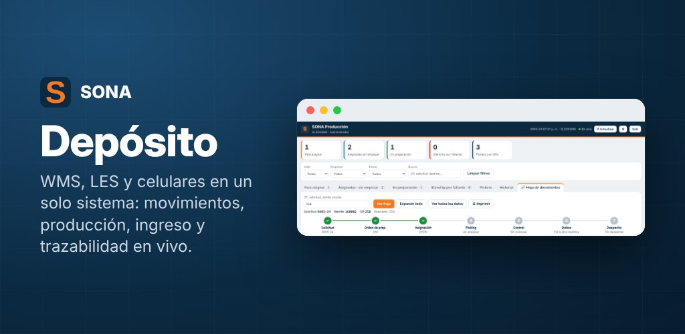
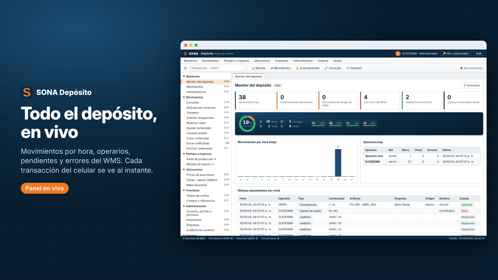
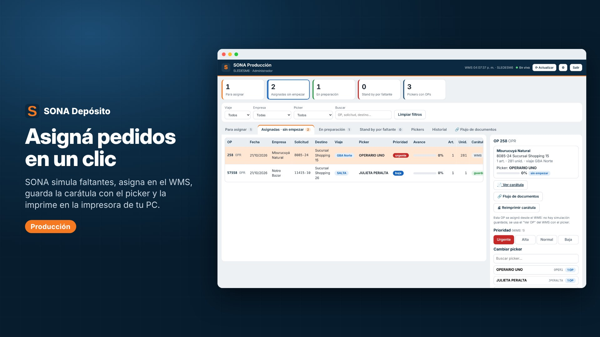
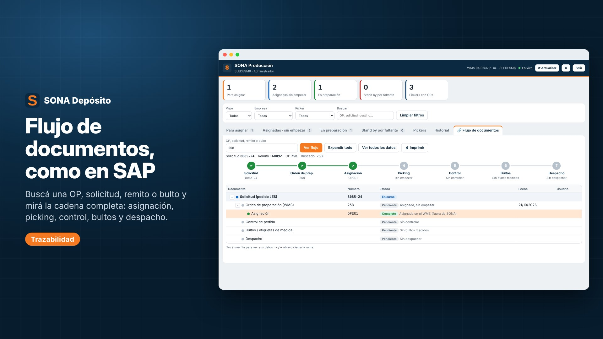
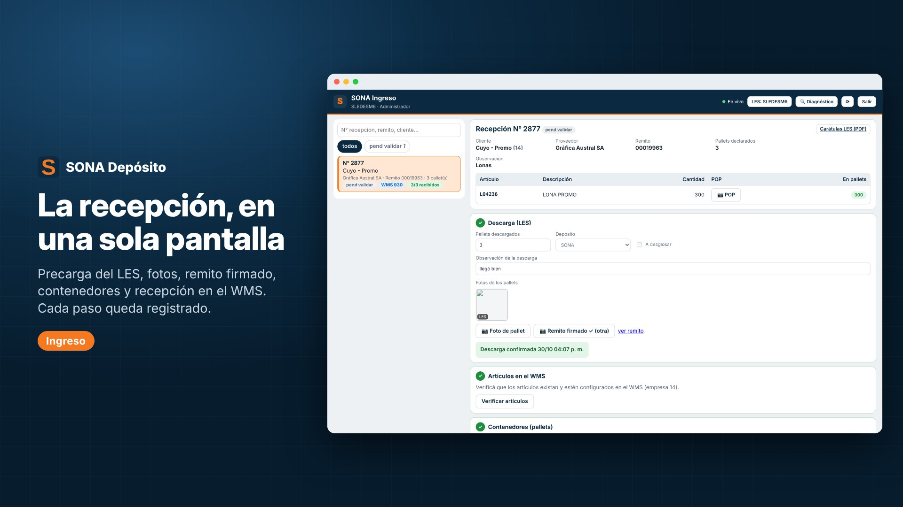
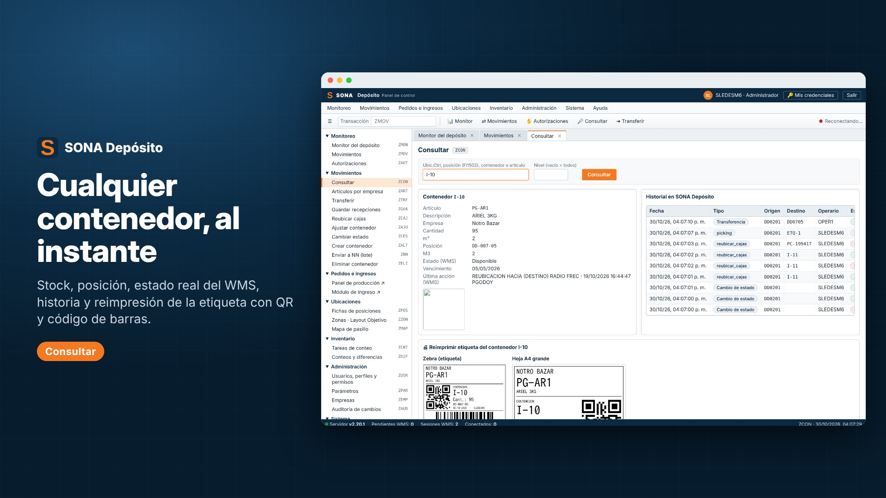
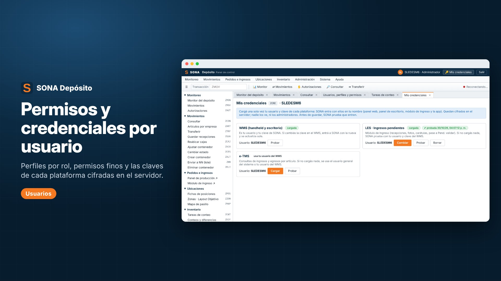
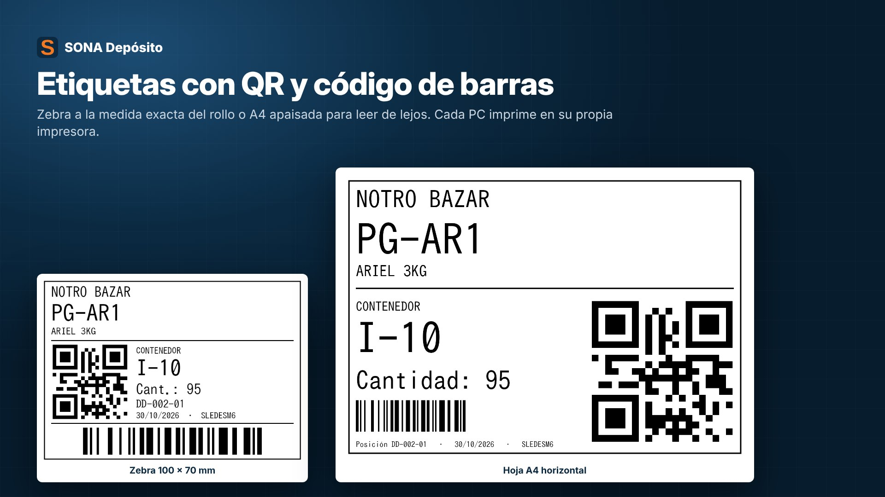
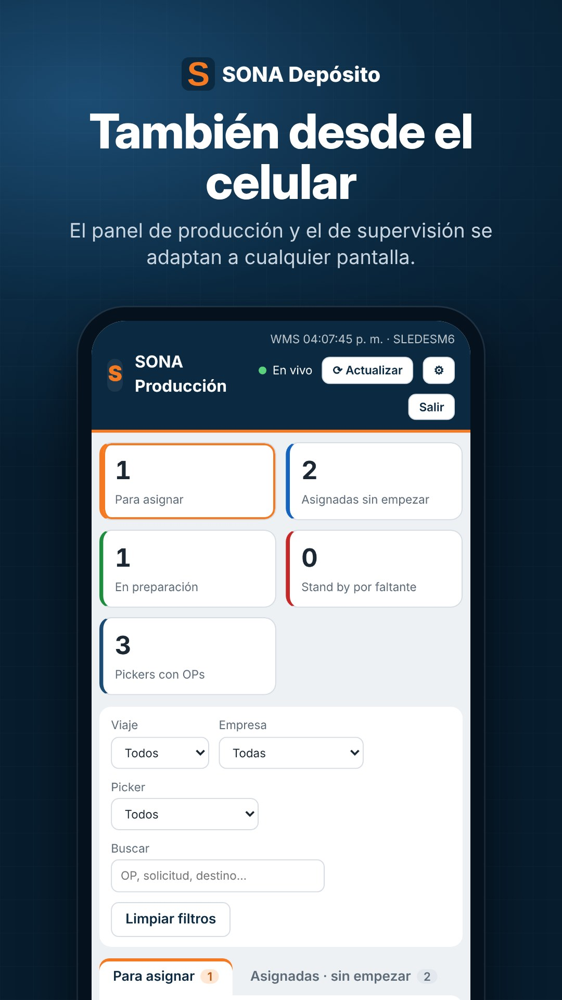
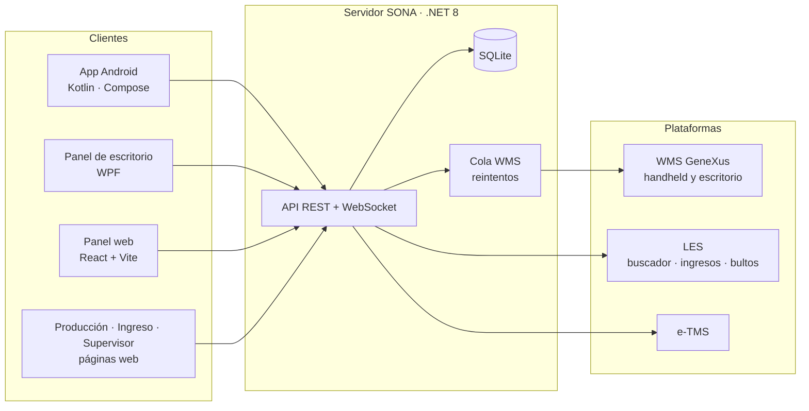

<p align="center">
  
</p>

> **Vitrina pública.** Esta es una copia del proyecto con **datos de ejemplo**: las personas, los clientes, los locales,
> las direcciones IP y los dominios son ficticios. El sistema real funciona en producción en un depósito logístico.

# SONA Depósito

**Una sola plataforma para operar el depósito:** une el WMS (GeneXus, handheld y escritorio), el LES, el e-TMS y los celulares de los operarios. Todo lo que pasa en el depósito se registra, se ve en vivo y queda trazado de punta a punta.

- **App Android** para operarios: consultar, transferir, guardar, picking, control de bultos, conteos y reconocimiento de artículos por foto.
- **Panel de escritorio (WPF)** que además *es* el servidor, y **panel web (React)** con las mismas transacciones.
- **Panel de producción**: asignación de pedidos a pickers en un clic, prioridades, stand-by por faltante y flujo de documentos al estilo SAP.
- **Módulo de ingreso**: la recepción de mercadería en una sola pantalla, desde la precarga del LES hasta la recepción en el WMS.
- **Servidor .NET 8**, que corre integrado en el panel, como servicio de Windows o en Docker.

> Versión actual: **servidor 2.20.1 · app 1.22**. Más de 30 000 líneas entre C#, Kotlin y TypeScript, con **230 pruebas de punta a punta** contra un WMS simulado con las pantallas reales.

---

## Galería

| | |
|---|---|
|  |  |
|  |  |
|  |  |
|  |  |

Más capturas en [`docs/imagenes/capturas`](docs/imagenes/capturas). Todas usan **datos de ejemplo**.

---

## Qué resuelve

| Antes | Con SONA Depósito |
|---|---|
| Cada movimiento se carga a mano en la handheld del WMS. | El operario lo hace desde la app. SONA lo graba en su base y en paralelo en el WMS, con reintentos y autorizaciones. |
| Para asignar un pedido hay que simular faltantes, guardar la carátula, asignar y confirmar, paso por paso en el WMS. | Un clic en el panel de producción: SONA hace todos los pasos y la carátula sale con el picker sellado. |
| Para seguir un pedido hay que revisar tres sistemas. | **Flujo de documentos**: se busca una OP, una solicitud, un remito o un bulto y se ve la cadena completa. |
| La recepción se carga en el LES y después en el WMS, sin registro unificado. | Una sola ventana guía la recepción, con fotos, remito firmado, contenedores, recepción en el WMS y cierre en el LES. |
| No se sabe quién hizo qué ni cuánto. | Auditoría de cada cambio, productividad por operario y monitor en vivo. |

## Módulos

- **Movimientos**: transferir (contenedor, posición completa, multicontenedor), guardar recepciones, reubicar cajas, ajustar, cambiar estado, crear contenedor, enviar a NN y eliminar. Cada movimiento queda en SONA y se aplica en el WMS con una cola con reintentos.
- **Consultar**: contenedor, posición, Ubic.Ctrl o artículo, con el estado real del WMS, fotos, historia, ingresos y egresos (e-TMS) y reimpresión de etiqueta con QR y código de barras.
- **Picking**: lista de OPs del picker, recorrido por posición, postergar, faltantes que pasan la OP a stand-by y avisos al panel.
- **Control de pedido y de bulto**: medidas, etiquetas por puesto y control de solicitud con foto.
- **Inventario**: tareas de conteo ciego, por confirmación o por artículo, y revisión de diferencias.
- **Producción**: tablero por estado, asignación y reasignación con prioridad, carátulas, historial y flujo de documentos.
- **Ingreso**: bandeja del LES con SLA, descarga, fotos, artículos y contenedores en el WMS, recepción y cierre.
- **Administración**: usuarios, perfiles y permisos finos, parámetros, empresas y alias, auditoría, actualización de la app desde el panel y credenciales por usuario.
- **IA**: reconocimiento de artículos por foto (ONNX) con aprendizaje desde las fotos confirmadas.

## Arquitectura



El servidor habla con el WMS como lo haría una persona: lee y completa las pantallas web de GeneXus (handheld y escritorio). No hace falta acceso a la base del WMS. El detalle está en [docs/ARQUITECTURA.md](docs/ARQUITECTURA.md).

## Estructura del repositorio

```
servidor/      .NET 8 · Sona.Core (núcleo y API), Sona.Servidor (servicio/Docker), Sona.Panel (WPF), pruebas de punta a punta
web/           panel web (React + TypeScript + Vite); el build va a servidor/panel-web
android/       app de los operarios (Kotlin + Jetpack Compose)
docs/          documentación técnica, de instalación y de operación
herramientas/  scripts de mantenimiento (por ejemplo, armar la vitrina pública sin datos reales)
Dockerfile     imagen del servidor con el panel web incluido
```

## Empezar rápido

```bash
# panel web -> servidor/panel-web
cd web && npm ci && npm run build && cd ..

# servidor + pruebas de punta a punta (230 casos contra un WMS simulado)
cd servidor
dotnet build pruebas/Sona.Pruebas -c Release
dotnet run --no-build --project pruebas/Sona.Pruebas -c Release      # debe terminar en "TODO OK"

# demo local con datos de ejemplo: http://127.0.0.1:18080/produccion (20 min)
SONA_DEMO=1 SONA_PRUEBAS=1 dotnet run --no-build --project pruebas/Sona.Pruebas -c Release

# servidor en Docker
cd .. && docker compose up -d
```

La guía completa está en [docs/DESARROLLO.md](docs/DESARROLLO.md) y la de puesta en producción en [docs/INSTALACION.md](docs/INSTALACION.md).

## Documentación

| Documento | Para quién | Contenido |
|---|---|---|
| [ARQUITECTURA](docs/ARQUITECTURA.md) | IT / desarrollo | Componentes, flujo de datos, base, cola WMS, eventos, decisiones |
| [INTEGRACIONES](docs/INTEGRACIONES.md) | IT / desarrollo | Qué pantallas del WMS, LES y e-TMS se usan y cómo |
| [DESARROLLO](docs/DESARROLLO.md) | Desarrollo | Compilar, probar, demo, publicar y versionar |
| [INSTALACION](docs/INSTALACION.md) | IT | Servidor (servicio, panel o Docker), red, firewall, celulares |
| [OPERACION](docs/OPERACION.md) | IT / soporte | Respaldos, registro, capturas, problemas frecuentes |
| [SEGURIDAD](docs/SEGURIDAD.md) | IT | Usuarios, permisos, claves cifradas, secretos que no van al repo |
| [API](docs/API.md) | Desarrollo | Todos los endpoints del servidor |
| [PENDIENTES](docs/PENDIENTES.md) | Todos | Qué falta y próximos pasos |

## Tecnologías

**Servidor:** .NET 8, ASP.NET Core minimal APIs, SQLite, SkiaSharp, Docnet (PDF), QRCoder, ONNX Runtime y ClosedXML.
**Escritorio:** WPF (.NET 8), un solo `.exe` autocontenido.
**Web:** React 18, TypeScript y Vite.
**Android:** Kotlin, Jetpack Compose, CameraX, ML Kit (códigos de barras) y ARCore (medición de bultos).
**Pruebas:** proyecto de consola que levanta el servidor real contra un WMS, LES y e-TMS simulados con las pantallas capturadas.

## Autor

Ideado y desarrollado por **Mauricio Fernández**.

## Licencia

**Todos los derechos reservados.** El código se publica solo para consulta. Ver [LICENSE](LICENSE).
