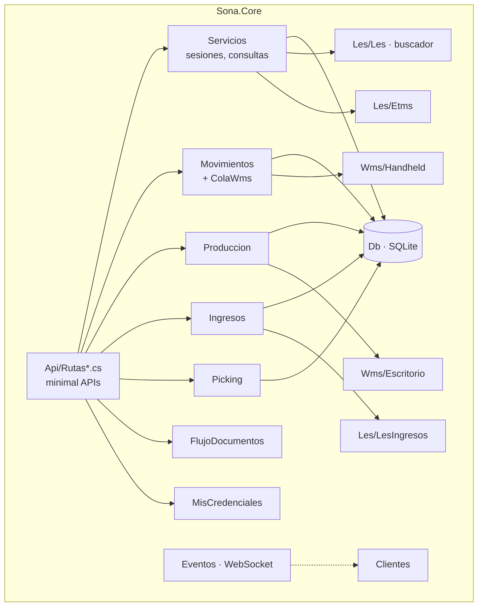

# Arquitectura

## Visión general

SONA Depósito es un **servidor .NET 8** con varios clientes:

| Cliente | Tecnología | Para quién |
|---|---|---|
| App Android | Kotlin + Jetpack Compose | Operarios (maquinistas, pickers, controladores, conteo) |
| Panel de escritorio | WPF, un solo `.exe` | Supervisión y administración. **Incluye el servidor** (modo integrado) |
| Panel web | React + TypeScript + Vite (`/`) | Las mismas transacciones que el panel de escritorio, desde cualquier navegador |
| Producción | HTML + JS sin dependencias (`/produccion`) | Sector que asigna pedidos a los pickers |
| Ingreso | HTML + JS (`/ingresos`) | Sector de recepción de mercadería |
| Supervisor | HTML + JS (`/supervisor`) | Supervisores (solo mirar) |

Todos usan la misma API REST y un WebSocket de eventos en vivo.

## Proyectos (`servidor/`)

| Proyecto | Qué es |
|---|---|
| `src/Sona.Core` | Todo el núcleo: API, lógica, base, clientes del WMS, LES y e-TMS, etiquetas, PDF, IA y páginas web embebidas (`Recursos/`). |
| `src/Sona.Servidor` | Ejecutable sin pantalla: servicio de Windows, systemd o Docker. Solo arranca `Motor`. |
| `src/Sona.Panel` | Panel WPF. En modo **integrado** levanta el servidor adentro; en modo **remoto** se conecta a otro. |
| `pruebas/Sona.Pruebas` | Pruebas de punta a punta: levanta el servidor real contra un WMS, LES y e-TMS simulados (`Fake*.cs`, `paginas/`). |

`Motor.Crear(...)` arma la aplicación (inyección de dependencias, rutas, servicios en segundo plano). Los usan igual el panel, el servicio y las pruebas.

## Datos

- **SQLite** (`sona.db`) en la carpeta de datos: `C:\ProgramData\SONA\Deposito` en Windows, `/datos` en Docker o lo que diga `SONA_DATOS`.
- El esquema se crea y se migra solo al arrancar (`Db.cs`: `CREATE TABLE IF NOT EXISTS` y `Migrar`). Cada módulo declara su `Esquema`.
- Tablas principales:
  - `movimientos`: todo lo que hace un operario, con su estado en el WMS;
  - `usuarios`, `perfiles` y `permisos`;
  - `produccion_caratulas`, `picking_eventos`, `op_items` y `faltantes`;
  - `ingresos`, `ingreso_pallets`, `ingreso_fotos` e `ingreso_eventos`;
  - `control_pedidos`, `credenciales` y `auditoria`.
- **Respaldo diario** automático (se guardan los últimos 30) en `respaldos/`.
- Otros archivos en la carpeta de datos:
  - `config.json`: configuración, con las claves cifradas;
  - `secreto.key`: la llave de cifrado, propia de cada instalación;
  - `fotos/`, `ia/`, `app/` (el APK para actualizar los celulares), `registro/` y `capturas/`.

## Cómo se escribe en el WMS

El WMS (GeneXus) no tiene una API: SONA usa **las mismas pantallas web que una persona** (`Wms/Navegador.cs` y `Wms/Gx.cs` leen y completan formularios GeneXus).

1. El operario hace el movimiento en la app.
2. SONA lo guarda en `movimientos` con estado `pendiente_wms`.
3. La **ColaWms** (servicio en segundo plano) lo aplica en el WMS por el **handheld**, con el usuario y la clave del propio operario. Si el WMS rechaza o no responde, reintenta con espera creciente y deja la respuesta guardada.
4. Si el destino está en la zona de otro cliente, el movimiento queda `esperando_autorizacion` hasta que un supervisor lo apruebe (ZAUT).

Producción usa el **WMS de escritorio** (`Wms/Escritorio.cs`) para simular faltantes, guardar la carátula PDF, asignar y confirmar. Lo hace con el usuario del panel de producción.

## Eventos en vivo

`Eventos.cs` mantiene un WebSocket por cliente (`/api/eventos`). Cada cambio relevante emite un evento con un filtro por usuario o rol: movimiento, autorización, asignación, faltante, mensaje o ingreso. Los paneles y la app se actualizan sin recargar. Al detener el servicio, las conexiones se cortan enseguida.

## Seguridad (resumen)

- **Login**: con el usuario y la clave **del WMS**. SONA valida contra el WMS y guarda la clave cifrada, porque la necesita para operar en nombre del usuario.
- **Permisos**: por perfiles (rol) más permisos sumados o quitados por usuario. El servidor los verifica en cada ruta, no solo la interfaz.
- **Credenciales de otras plataformas**: cada usuario carga las suyas en *Mis credenciales*. Se prueban antes de guardarse y quedan cifradas con la llave de la instalación.

El detalle está en [SEGURIDAD.md](SEGURIDAD.md).

## Impresión

- **Desde cada PC (por defecto):** el servidor arma una página con las imágenes en el tamaño exacto, con `@page` en mm y A4 vertical u horizontal según la hoja. El navegador la abre en un marco oculto y muestra el diálogo de impresión de esa computadora (`PaginaImpresion.cs`).
- **En el servidor (opcional):** impresión directa en una impresora instalada en la PC del servidor (`Caratula.ImprimirImagenes`, solo en Windows). Para las etiquetas fuerza el tamaño de papel. La usa la app (etiquetas de bultos por puesto).

## Decisiones de diseño

- **Un solo núcleo para todo.** El panel integrado, el servicio, Docker y las pruebas ejecutan exactamente el mismo `Motor`.
- **SQLite.** Un depósito genera pocos miles de movimientos por día. SQLite alcanza de sobra, no necesita un servidor de base y el respaldo es copiar un archivo.
- **Sin acceso directo a las bases del WMS ni del LES.** Todo pasa por sus pantallas o endpoints web, igual que un usuario. No hace falta permiso de base de datos ni tocar esos sistemas.
- **Pruebas contra pantallas reales capturadas.** Si el WMS cambia una pantalla, la prueba correspondiente falla antes de llegar a producción.
